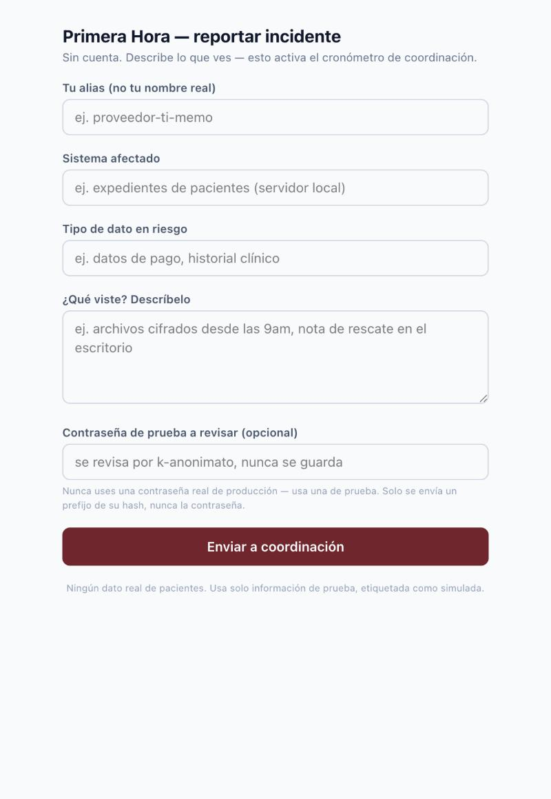
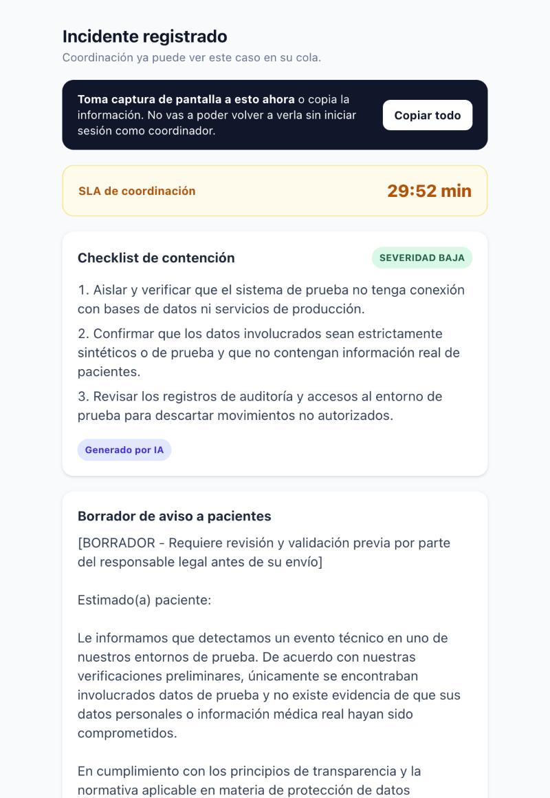

# PERSONA TEST — Layer 1 (Memo)

Business Bending · Cristina Meouchi (OPERATOR) · Repair Flow, Crystal Ball Studio · Team 8 · w08

## Quién es Memo

Memo, 34 años, administra la infraestructura de TI de 3-4 clínicas y despachos pequeños en CDMX
como micro-empresa/freelance. No tiene formación formal en ciberseguridad ni un protocolo
escrito. Hoy, ante un ransomware o un acceso raro, su plan es "buscar en Google y tratar de no
entrar en pánico mientras el cliente le marca sin parar". Es exactamente lo que abre `/triage` en
el peor momento de su semana — sin cuenta, sin que nadie le haya explicado cómo funciona.

## Metodología

Se caminó la app desde cero, como la vería Memo la primera vez: sin leer el Packet, sin saber qué
esperar de cada campo, con la urgencia de alguien reportando un ransomware real. Se documentó
cada punto donde un usuario sin contexto podría confundirse, dudar, o perder información crítica.

## Paso 1 — Llega a `/triage`

Memo entra sin cuenta, como promete el Brief. El formulario es corto (5 campos) y cada uno tiene
un ejemplo (placeholder) que aclara qué se espera — esto funciona bien: no hay ambigüedad sobre
qué escribir en "Sistema afectado" o "¿Qué viste?".

**Punto de confusión menor #1 — el campo de contraseña.** La etiqueta dice "Contraseña de prueba
a revisar (opcional)" y el texto de ayuda insiste "nunca uses una contraseña real de producción —
usa una de prueba". Para Memo, en medio de un incidente real, esto genera una duda legítima: ¿la
herramienta no sirve para revisar la contraseña que de verdad se filtró? La razón real (nunca se
debe procesar una credencial real en una demo sin infraestructura de respuesta detrás) es
correcta y no se debe cambiar — pero vale la pena que un futuro ciclo de iteración aclare en el
texto que esto es una limitación intencional de la versión actual, no una limitación del método
(k-anonimato) en sí. No se corrigió en este ciclo: es menor y no bloquea el flujo.

## Paso 2 — Envía el reporte

Se llenó el formulario con una descripción de ransomware (archivos cifrados, nota de rescate) y
una contraseña de prueba conocida como filtrada. El botón cambia a "Enviando a coordinación..."
mientras procesa — da una señal clara de que algo está pasando, importante para alguien ansioso
que podría dar doble clic si no ve feedback.

## Paso 3 — Resultado

Antes del fix, la pantalla de resultado decía únicamente: *"Guarda esta pantalla — no podrás
volver a verla sin iniciar sesión."*

**Punto de confusión mayor (el peor encontrado) — "guarda esta pantalla" no dice cómo, y no da
ninguna forma de hacerlo.** Memo está viendo, en este momento, el checklist de contención y el
borrador de aviso a pacientes — la información más importante que va a necesitar en la próxima
hora. Si cierra la pestaña sin querer, se le va la señal del wifi, o simplemente olvida el aviso
mientras atiende la llamada del cliente, pierde esa información para siempre: no hay correo de
confirmación, no hay link para volver a verla, no hay número de caso que pueda anotar rápido. En
el peor momento de su semana, es exactamente la información que no se puede dar el lujo de
perder.

### Fix aplicado

Se reemplazó el aviso vago por una instrucción concreta y un mecanismo real:

- El texto ahora dice explícitamente **"Toma captura de pantalla a esto ahora"** — una acción que
  cualquier persona con un celular sabe hacer, sin importar su nivel técnico.
- Se agregó un botón **"Copiar todo"** que copia al portapapeles un resumen en texto plano
  (severidad, checklist completo, borrador de aviso, ID del incidente) — listo para pegar en
  WhatsApp, notas, o un correo, sin depender de que la captura de pantalla salga completa o
  legible.
- La instrucción de captura de pantalla es independiente del botón: si el portapapeles fallara
  por cualquier razón del navegador del usuario, la instrucción principal (tomar captura) sigue
  siendo visible y sigue siendo accionable.

Código: `src/app/triage/page.tsx`, función `copiarResumen()`. Verificado con build + lint locales
antes de desplegar, y confirmado en producción (`https://w08-primera-hora-x22e.vercel.app`).

## Resumen de hallazgos

| # | Hallazgo | Severidad | Resuelto |
|---|---|---|---|
| 1 | Campo de contraseña puede confundir en un incidente real vs. de prueba | Menor | No (documentado para siguiente ciclo) |
| 2 | "Guarda esta pantalla" sin decir cómo, sin forma de hacerlo | **Mayor** | **Sí — botón de copiar + instrucción concreta** |
